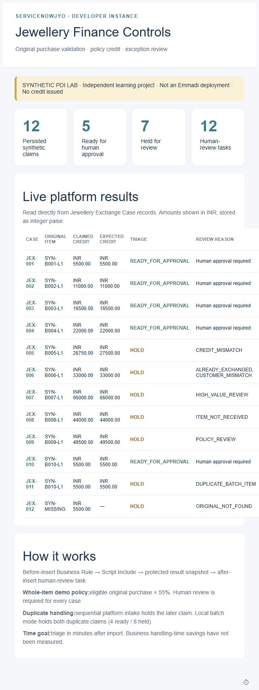
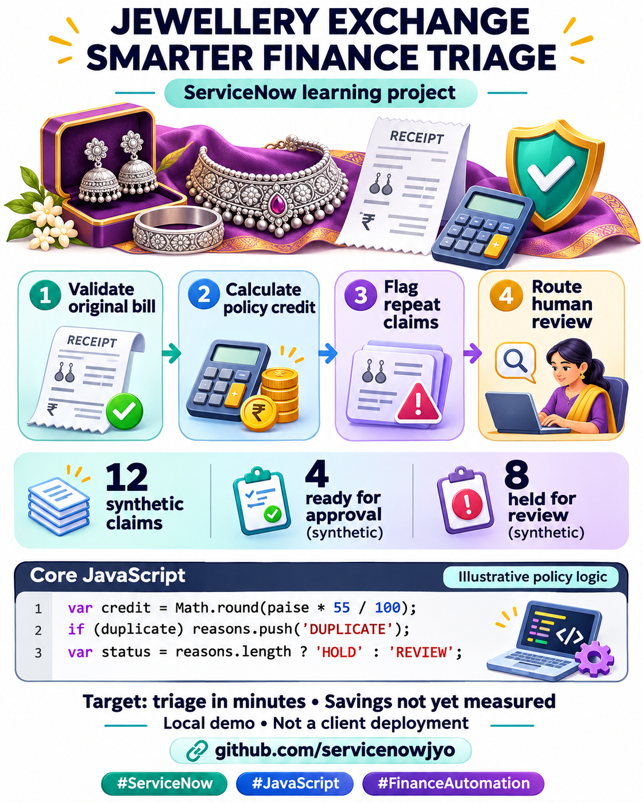

# Jewellery Exchange Controls — ServiceNow learning project

An independent, synthetic Indian jewellery retail case study by `servicenowjyo`. It checks original purchase snapshots against exchange claims, calculates 55% credit, and routes exceptions for human review. Inspired by Emmadi Silver Jewellery's public FAQ; **not commissioned, endorsed, or deployed by Emmadi**. Tirupati is a hypothetical demo location; no verified claim about its branch or internal operations.

## Results actually obtained
Run `npm test` then `npm run demo` (Node 18+; no packages required). Local simulation: **12 synthetic claims, 4 ready for approval, 8 held**. All claims still require human approval. See `evidence/results.json` and `evidence/test-output.txt`. The ServiceNow PDI was also built and verified: **12 persisted claims, 5 ready, 7 held, 12 automatically created human-review tasks**. Its sequential duplicate check flags the later claim; batch mode flags both. Five authentic ServiceNow screenshots are in `evidence/screenshots/`. The standalone HTML dashboard is a separate local simulation.

## Why this problem
Original-bill lookup, credit recalculation, repeat claims, and manager handoffs can create repetitive work. We do not know Emmadi's existing systems, error rates or handling times. The prototype automates triage only; item inspection, ownership verification, tax treatment and issuing exchange credit remain controlled human/business processes. No cash refund is created.

## Open the verified PDI dashboard
After signing into your developer instance, open `/jewellery_finance_demo.do`. Native cases: `/u_jewel_exchange_case_list.do`. The dashboard reads live persisted records and restricts its displayed content to admin. It is a custom UI Page, not a native Performance Analytics dashboard. Review automation was implemented with Business Rules, not Flow Designer; a Flow Designer alternative is documented.

## Files
- `data/`: synthetic claims CSV, trusted bill snapshots and consumed-item ledger.
- `src/`: runnable JavaScript policy and result runner.
- `tests/`: boundary, malformed-input and duplicate tests.
- `servicenow/`: Script Include, before-insert rule, immutable-intake rule, schema and PDI seed scripts.
- `docs/STEP_BY_STEP.md`: build and verify lab using your existing Task knowledge.
- `docs/SOURCES.md`: public business facts and lawful free book/PDF reading links.
- `PROMPT.md`: executed project prompt; `media/IMAGE_PROMPT.txt`: infographic prompt.
- `CLAUDE_HANDOFF.md`: upload instructions and evidence restrictions.

## Important limits
55% is a configurable example based on a public FAQ, not a universal jewellery rule. The eligible purchase base, item condition, partial returns, tax and policy versions require merchant validation. All demo values are INR paise. High-value threshold ₹50,000 is an invented training control. Tax calculation and HUID verification are out of scope: silver and gold requirements differ. No production integrations, live money or customer data.

Sequential ServiceNow intake sees a duplicate only when a prior case exists; batch mode holds both matching claims. They therefore have different expected counts (PDI: 5 ready/7 held; batch: 4 ready/8 held). Duplicate intake queries alone are not a concurrency guarantee. A production redemption operation needs a unique bill-line ledger, atomic reservation, maker/checker authorization and controlled ERP integration. This demo never creates redemption from approval.

## Time target
Goal: triage a small claim batch in under 5 minutes after import. No measured hours-to-minutes claim about a real business. Local engine milliseconds exclude import, review and platform latency. Use `docs/BENCHMARK.md` before claiming savings.

